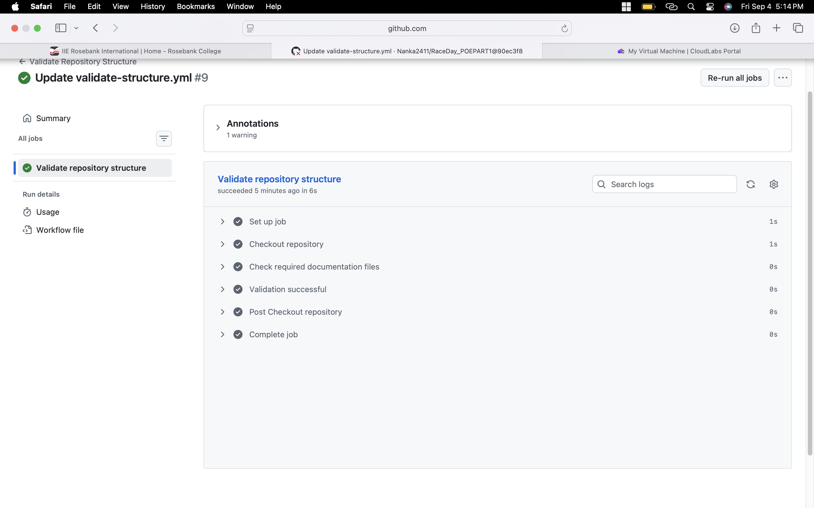

🏃‍♀️🏁 Race_Day

📌 Project Overview

Race_Day is a race and event management system designed to manage users, organisers, participants, events, event categories, enrolments, and race results.

The system uses a relational database to store and manage race-day information and provides REST API endpoints for interacting with the system. 🗄️💻

⸻

📚 Assignment Description

This assignment focuses on the design and development of a Race_Day race and event management system. The system is designed to demonstrate the use of database design, relational database management, REST API development, user roles, and version control.

The project requires the development of a structured database that manages race events, organisers, participants, categories, enrolments, and race results. It also includes REST API endpoints that allow users and organisers to interact with the system.

The project demonstrates the ability to:

* 🗄️ Design and implement a relational database.
* 🔗 Establish relationships between database tables using Primary Keys (PKs) and Foreign Keys (FKs).
* 🔌 Design REST API endpoints for system functionality.
* 👥 Implement different user roles and responsibilities.
* 📝 Manage participant enrolments in race events.
* 🏆 Record and manage race results.
* 🐙 Use GitHub for version control and project documentation.
* ⚙️ Use GitHub Actions to validate the repository structure.

⸻

🗄️ Database

The database is named:

Race_Day

📋 Database Tables

Table	Description
👤 Account	Stores user account information
🧑‍💼 Organiser	Stores information about event organisers
🏃 Participant	Stores information about race participants
🏁 Event	Stores race and event information
🏷️ Category	Stores available event categories
🔗 EventCategory	Links events with their available categories
📝 Entry	Stores participant enrolments in events
🏆 Result	Stores participant race results

🔗 Database Relationships

The database uses Primary Keys (PKs) and Foreign Keys (FKs) to maintain relationships and data integrity.

Key relationships include:

* 👤 An Account can be associated with an Organiser or Participant.
* 🧑‍💼 An Organiser can create multiple Events.
* 🏁 An Event can have multiple Categories.
* 🏃 A Participant can enter Events through the Entry table.
* 📝 Each Entry can have a corresponding Result.
* 🔗 Events and Categories are connected through the EventCategory relationship.

⸻

🔌 API Endpoints

The Race_Day system provides REST API endpoints for managing accounts, profiles, events, categories, enrolments, and race results.

🔐 Authentication

Method	Route	Description
🟢 POST	/api/auth/register	Registers a new user account
🟢 POST	/api/auth/login	Authenticates a registered user

👤 Profile

Method	Route	Description
🔵 GET	/api/profile	Retrieves the logged-in user’s profile
🟡 PUT	/api/profile	Updates the logged-in user’s profile

🏁 Events

Method	Route	Description
🔵 GET	/api/events	Retrieves all available events
🔵 GET	/api/events/{id}	Retrieves details of a specific event
🟢 POST	/api/events	Creates a new event
🟡 PUT	/api/events/{id}	Updates an existing event
🔴 DELETE	/api/events/{id}	Deletes an existing event

🏷️ Categories

Method	Route	Description
🔵 GET	/api/categories	Retrieves all available categories
🔵 GET	/api/categories/{id}	Retrieves details of a specific category
🟢 POST	/api/categories	Creates a new category

🔗 Event Categories

Method	Route	Description
🟢 POST	/api/events/{eventId}/categories/{categoryId}	Associates a category with an event
🔵 GET	/api/events/{eventId}/categories	Retrieves categories associated with an event

📝 Enrolments

Method	Route	Description
🟢 POST	/api/events/{eventId}/enrolments	Enrols a participant in an event
🔵 GET	/api/events/{eventId}/enrolments	Retrieves participants enrolled in an event
🔵 GET	/api/enrolments	Retrieves the logged-in participant’s enrolments
🔴 DELETE	/api/events/{eventId}/enrolments	Cancels a participant’s enrolment

🏆 Results

Method	Route	Description
🔵 GET	/api/events/{eventId}/results	Retrieves results for an event
🔵 GET	/api/results/{id}	Retrieves a specific race result
🟢 POST	/api/entries/{entryId}/results	Records a participant’s result
🟡 PUT	/api/results/{id}	Updates an existing result

⸻

👥 User Roles

The Race_Day system has two main user roles: Organiser and Participant.

🧑‍💼 Organiser

An Organiser is responsible for managing race events and overseeing participants and results.

Organisers can:

* 🏁 Create and manage race events.
* 🏷️ Create and manage event categories.
* 🔗 Associate categories with events.
* 👥 View participants enrolled in their events.
* 🏆 Record race results.
* ✏️ Update race results.
* 📋 Manage information relating to their events.

🏃 Participant

A Participant is a user who takes part in race events managed through the system.

Participants can:

* 🔎 View available race events.
* 📋 View event details.
* 📝 Enrol in available events.
* 👀 View their own enrolments.
* ❌ Cancel their enrolments.
* 🏆 View race results.

The two roles ensure that users have appropriate responsibilities within the system and that event management activities are separated from participant activities. 🔐

⸻

🛠️ Technologies Used

* 🗄️ Microsoft SQL Server
* 💾 SQL
* 🔌 REST API
* 🐙 GitHub
* ⚙️ GitHub Actions

⸻

⚙️ Continuous Integration (CI)

GitHub Actions is used as part of the project’s Continuous Integration (CI) process.

The CI workflow automatically checks that the required project documentation files are present in the repository whenever changes are pushed to the main or master branches or when a pull request is created.

The workflow checks for:

* 📄 API_Endpoint_Plan.pdf
* 🖼️ ERDDIAGRAM.drawio.png
* 🗄️ RACE_DAY PROG_POE1.sql
* 📖 README.md

A successful workflow produces a green build, confirming that the required files have been found successfully. ✅

🟢 Successful CI Build

⸻
## 🎥 Project Walkthrough Video

[Watch my Race_Day Project Walkthrough on YouTube]

(https://youtu.be/yLE7oBicH00)
⸻

🎯 Project Purpose

The purpose of Race_Day is to provide a structured and reliable system for managing race events and participants.

The system brings together:

🏁 Events
👥 Participants
🧑‍💼 Organisers
🏷️ Categories
📝 Enrolments
🏆 Race Results

All while maintaining data integrity and organised database relationships. 🔐✨

⸻

🚀 Race Day Ready!

Plan the race. 🏁
Manage the participants. 🏃
Track the results. 🏆

⸻

🏃‍♀️🏁 Race_Day — Part 2

📌 Project Overview

Race_Day is a race and event management system designed to manage user accounts, organisers, participants, race events, event categories, enrolments, and race results.

Part 2 develops the system further through a RESTful API built with ASP.NET Core and .NET 8. The project includes account registration and login, event-management endpoints, automated API tests, and a Continuous Integration (CI) workflow using GitHub Actions.

The system aims to provide a structured way to manage race-day information while maintaining data integrity, appropriate user access, and reliable application behaviour.

⸻
🎯 Project Objectives

The main objectives of Race_Day are to:

🗄️ Design and implement a relational database.
🔌 Develop a RESTful API using ASP.NET Core.
🔐 Manage user registration and authentication.
👥 Support organiser and participant roles.
🏁 Provide endpoints for retrieving and managing race events.
🏷️ Manage categories, enrolments, and race results where implemented.
🧪 Test API behaviour using automated tests.
🐙 Use GitHub for source control and project documentation.
⚙️ Use GitHub Actions to build and test the application automatically.
⸻

🏁 System Features

🔐 Account Management

Register a new user account.
Log in using registered credentials.
Validate invalid registration and login requests.
Support user roles for access control.

🏃 Event Management

Retrieve available race events.
Retrieve individual event details.
Create race events, subject to authorisation.
Update and delete events where permitted.
Restrict event-management operations according to user permissions.
⸻
👥 User Roles

Race_Day supports two main user roles: Organiser and Participant.

🧑‍💼 Organiser

An Organiser is responsible for managing race events and overseeing event-related activities.

Organisers are intended to be able to:

🏁 Create new race events.
📋 View and manage their events.
✏️ Update event information.
🗑️ Delete events where authorised.
🏷️ Manage event categories where implemented.
👥 View participant enrolments where implemented.
🏆 Record and update race results where implemented.
Organiser permissions help ensure that event-management activities are restricted to authorised users.

🏃 Participant

A Participant is a user who registers to take part in race events.

Participants are intended to be able to:

📝 Register an account and log in.
🔎 View available race events.
📋 View event details.
🏁 Enrol in available events where implemented.
👀 View their own enrolments where implemented.
❌ Cancel enrolments where implemented.
🏆 View race results where implemented.
Participants should not be allowed to perform organiser-only actions, such as creating events, unless explicitly permitted by the application's authorisation rules.

Note: The available functionality for each role depends on the endpoints and authorisation rules implemented in the current Part 2 branch.
⸻

🛠️ Technologies Used

Technology	Purpose
C#	Application programming language
.NET 8	Application framework
ASP.NET Core Web API	REST API development
Entity Framework Core	Database access and object-relational mapping
Microsoft SQL Server	Relational database
Entity Framework Core InMemory	In-memory database support for testing
BCrypt.Net-Next	Password hashing support
xUnit	Automated testing
Microsoft.AspNetCore.Mvc.Testing	API integration testing
GitHub	Source control and project hosting
GitHub Actions	Continuous Integration
⸻
🗄️ Database

The database for the project is named Race_Day.

📋 Database Tables

Table	Description
Account	Stores user account information
Organiser	Stores organiser information
Participant	Stores participant information
Event	Stores race event details
Category	Stores event categories
EventCategory	Connects events to categories
Entry	Records participant enrolments
Result	Stores race results
🔗 Database Relationships

The database uses Primary Keys (PKs) and Foreign Keys (FKs) to establish relationships between records and maintain data integrity.

Key relationships include:

An Account can be associated with an Organiser or Participant.
An Organiser can manage multiple Events.
An Event can be associated with multiple Categories.
A Participant can enter Events through the Entry table.
An Entry can have a corresponding Result.
Events and Categories are connected through the EventCategory relationship.
The API uses Entity Framework Core to access database data. The test project also uses Entity Framework Core InMemory to support isolated testing.

⚙️ Database Configuration

Configure the database connection string according to your local SQL Server environment.

Make sure the database exists and that the application has the required permissions. If your project uses Entity Framework Core migrations, apply the required migrations before running the API.

Important: Do not commit database passwords, connection-string credentials, or other secrets to GitHub.
⸻

🔌 API Endpoints

The following tables describe the planned API functionality. Confirm each route against the controllers implemented in the current Part 2 branch.

🔐 Authentication

Method	Route	Description
POST	/api/auth/register	Registers a new user account
POST	/api/auth/login	Authenticates a registered user

👤 Profile

Method	Route	Description
GET	/api/profile	Retrieves the logged-in user's profile
PUT	/api/profile	Updates the logged-in user's profile

🏁 Events

Method	Route	Description
GET	/api/events	Retrieves available events
GET	/api/events/{id}	Retrieves a specific event
POST	/api/events	Creates an event
PUT	/api/events/{id}	Updates an event
DELETE	/api/events/{id}	Deletes an event

🏷️ Categories

Method	Route	Description
GET	/api/categories	Retrieves available categories
GET	/api/categories/{id}	Retrieves a specific category
POST	/api/categories	Creates a category

🔗 Event Categories

Method	Route	Description
POST	/api/events/{eventId}/categories/{categoryId}	Associates a category with an event
GET	/api/events/{eventId}/categories	Retrieves categories associated with an event

📝 Enrolments

Method	Route	Description
POST	/api/events/{eventId}/enrolments	Enrols a participant in an event
GET	/api/events/{eventId}/enrolments	Retrieves enrolments for an event
GET	/api/enrolments	Retrieves the logged-in participant's enrolments
DELETE	/api/events/{eventId}/enrolments	Cancels an enrolment

🏆 Results

Method	Route	Description
GET	/api/events/{eventId}/results	Retrieves results for an event
GET	/api/results/{id}	Retrieves a specific result
POST	/api/entries/{entryId}/results	Records a participant's result
PUT	/api/results/{id}	Updates a result
Note: Only endpoints implemented in the current Part 2 branch should be considered available. Authentication requirements, HTTP status codes, and permissions depend on the implementation.
⸻

⚙️ Installation and Setup

📋 Prerequisites

Before running the application, ensure that you have installed:

.NET 8 SDK
Visual Studio 2022 with the ASP.NET and web development workload, or another compatible C# development environment.
Git, for cloning the repository.
Microsoft SQL Server, if using the SQL Server database configuration.
1️⃣ Clone the Repository

Open a terminal or command prompt and run:

git clone https://github.com/Nanka2411/RaceDay_POEPART1.git
cd RaceDay_POEPART1
2️⃣ Switch to the Part 2 Branch

Run the following command:

git checkout RaceDay_POEPART2
This switches to the branch containing the Part 2 work.

3️⃣ Restore Dependencies

From the directory containing RaceDayAPI.Tests.csproj, run:

dotnet restore RaceDayAPI.Tests.csproj
This downloads the required NuGet packages.

4️⃣ Build the Application and Tests

Run:
dotnet build RaceDayAPI.Tests.csproj --configuration Release
A successful build confirms that the API project and its referenced test project compile successfully.

5️⃣ Configure the Database

Configure your SQL Server connection string in the application's configuration.

Ensure that:

SQL Server is running, if required.
The connection string matches your local environment.
The database exists or is created through your application's configured database setup.
Required migrations have been applied, if your project uses migrations.
Do not publish private database credentials.

⸻
🚀 How to Run the Application

1️⃣ Start the API

Open a terminal in the directory containing RacedayApi.csproj and run:

dotnet run --project RacedayApi.csproj
Wait for the application to start and display its local URL.

2️⃣ Access the API

Open the URL displayed in the terminal in your browser or API client.

If Swagger is enabled for your current environment, open the configured Swagger URL to explore and test the available API endpoints.

3️⃣ Test an API Endpoint

For example, to retrieve available events, send a GET request to:

GET /api/events
To register a user, send a POST request to:

POST /api/auth/register
The exact request body and required fields depend on the API implementation.

⸻
🧪 Automated Testing

The test project uses xUnit, Microsoft.AspNetCore.Mvc.Testing, and Entity Framework Core InMemory to test selected API behaviours.

▶️ Run the Tests

From the directory containing RaceDayAPI.Tests.csproj, run:

dotnet test RaceDayAPI.Tests.csproj --configuration Release
✅ Current Test Scenarios

The existing test files cover scenarios including:

Registration with invalid data.
Login with invalid data.
Successful participant registration.
Login with valid credentials.
Login with an incorrect password.
Retrieving events without logging in.
Creating events without authentication.
Checking participant access to event creation.
Retrieving events that do not exist.
Deleting events without authentication.
The tests use an in-memory database to help isolate test data from the normal database.
⸻

🔄 Continuous Integration (CI) with GitHub Actions

GitHub Actions automates the build and test process when changes are pushed to the RaceDay_POEPART2 branch or when a pull request targets that branch.

⚙️ CI Workflow Steps

The workflow performs the following steps:

Checkout: Downloads the repository source code.
Setup .NET: Installs the .NET 8 SDK.
Restore: Restores the required dependencies.
Build: Builds the test project and its referenced API project.
Test: Runs the automated tests.
The CI workflow helps identify compilation errors and failing tests before changes are merged.

A successful workflow run indicates that the configured build and test commands completed successfully.

🖼️ Successful CI Workflow Screenshot

The screenshot below should show the successful RaceDayAPI CI workflow in GitHub Actions.

⸻

📁 Project Structure

The repository contains the API project, test project, application source files, and GitHub Actions workflow.

Important project files include:

RacedayApi.csproj — ASP.NET Core API project.
RaceDayAPI.Tests.csproj — automated test project.
Program.cs — application entry point and service configuration.
AccountTests.cs — account-related tests.
EventTests.cs — event-related tests.
UnitTest1.cs — additional event-access test.
CustomWebApplicationFactory.cs — test host and in-memory database configuration.
.github/workflows/ — GitHub Actions workflow files.

⸻

🔒 Security Considerations

Store passwords using secure password hashing rather than plaintext.
Protect restricted endpoints with authentication and role-based authorisation.
Keep database credentials and secrets out of source control.
Validate incoming API requests.
Use HTTPS and secure configuration in production environments.

⸻

🚧 Limitations and Future Improvements

Potential future improvements include:

Expanding automated test coverage for all API endpoints.
Improving input validation and error responses.
Adding more detailed API documentation.
Strengthening authentication and authorisation tests.
Improving database migration and deployment procedures.
Adding logging and monitoring for production.
These are potential improvements and should be reviewed against the features already implemented.

⸻
🎥 Project Walkthrough Video

Watch the Race_Day project walkthrough: https://youtu.be/lBTegCzIVco

⸻
🐙 Repository Links

GitHub Repository: https://github.com/Nanka2411/RaceDay_POEPART1.git
Part 2 Branch: https://github.com/Nanka2411/RaceDay_POEPART1/tree/RaceDay_POEPART2

⸻
🎯 Conclusion

Race_Day combines relational database design, REST API development, account management, race-event functionality, automated testing, and Continuous Integration.

The project demonstrates the development and validation of a structured API solution for managing race-day activities.

Plan the race. 🏁 Manage the participants. 🏃 Track the results. 🏆

